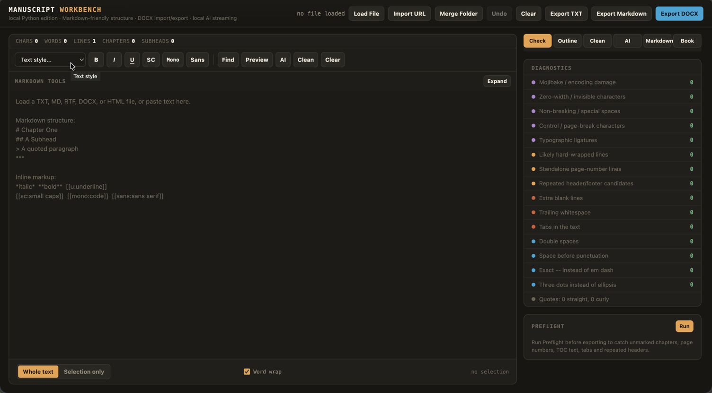

# Manuscript Workbench — Python edition

Local web app for cleaning manuscripts, structuring text with Markdown, importing files or URLs, keeping the work in projects with snapshots, exporting TXT, Markdown, DOCX and EPUB, running preflight checks, and rewriting, cleaning or translating text through local OpenAI-compatible providers such as LM Studio and oMLX, with a word-level review before anything is applied.

Everything runs on your own computer. The only network traffic is the AI provider you configure and the page you ask `Import URL` to fetch.

- User guide: [USER_GUIDE.md](USER_GUIDE.md)
- What changed in 2.0: [CHANGELOG.md](CHANGELOG.md)
- Where it is going, and what is known to be missing: [ROADMAP_AND_CHECK.md](ROADMAP_AND_CHECK.md)

## What it does

- **Clean and structure**: encoding repair, language-aware typography (English and Dutch), diagnostics, preflight, a chapter candidate manager, Find/Replace, Markdown structure with a live preview.
- **Projects**: `.mwb.json` files with autosave, conflict detection and automatic snapshots before risky actions.
- **AI review**: rewrite, clean, guided rewrite and translate with a Diff view (accept or reject each changed paragraph), a glossary of terms to keep, sections you can resume after an error, and content guardrails.
- **Import and export**: TXT, Markdown, RTF, DOCX (lists, tables and links included), HTML and URLs in; TXT, Markdown, DOCX and EPUB out.

## Screenshot



## Install

Python 3.9 or newer is needed. On macOS/Linux `./start_mac_linux.sh` and on Windows `start_windows.bat` create the virtual environment, install the packages and start the app. By hand:

```bash
cd "Manuscript Workbench"
python -m venv .venv
# macOS/Linux
source .venv/bin/activate
# Windows PowerShell
# .venv\Scripts\Activate.ps1
pip install -r requirements.txt
python app.py
```

Open the URL printed in the terminal, normally:

```text
http://127.0.0.1:8765
```

To use another port:

```bash
MANUSCRIPT_WORKBENCH_PORT=8766 ./start_mac_linux.sh
```

| Environment variable | Meaning | Default |
|---|---|---|
| `MANUSCRIPT_WORKBENCH_PORT` | port of the local server | `8765` |
| `MANUSCRIPT_WORKBENCH_DATA_DIR` | folder that holds `projects/` (projects, snapshots, `.trash`) | the app folder |

## Where your data lives

| What | Where |
|---|---|
| Projects and snapshots | `projects/` in the data folder (gitignored) |
| UI settings, prompts, browser autosave | the browser's localStorage (and `manuscript_workbench_settings.json` for settings, never the API key) |
| AI API key | the browser's localStorage only; the server never stores or returns it |

## Security model

The server only listens on `127.0.0.1`. Every call to its API needs a random per-start session token that only the page the app serves receives, requests with a foreign `Host` or `Origin` are refused, the page runs under a strict Content-Security-Policy (no inline script or style), the Markdown preview is sanitized and blocks remote images by default, and `Import URL` refuses private and internal addresses (also through redirects). Manuscript text is only sent to the AI endpoint you configure, and the app asks first when that endpoint is not on your own network. Details: [section 22 of the user guide](USER_GUIDE.md#22-known-limitations).

## Local AI Providers

The AI tab supports OpenAI-compatible local endpoints:

- LM Studio: `http://localhost:1234/v1`
- oMLX: `http://localhost:8000/v1`
- Ollama: `http://localhost:11434/v1`
- Custom OpenAI-compatible endpoint

Start your provider, choose it in the AI tab, click **Detect Model**, then choose the model.

For LM Studio the model list also shows which models are loaded and their context size, and suggests a chunk size. The app sends `model`, `messages`, and `stream`. Runtime settings such as temperature/top-p/context length stay in the provider app, unless you fill in the optional Advanced request options in the AI tab.

## Markdown Structure

Markdown structure is converted to Word paragraph styles during DOCX export:

```markdown
# Chapter One          -> Heading 1
## A Subhead           -> Heading 2
### Lower Subhead      -> Heading 3
> Quoted paragraph     -> block quote
***                    -> scene break
```

Extra manuscript blocks use fenced Markdown-style containers:

```markdown
::: verse
Poetry or song lines
:::

::: written-note
A note written by a character
:::
```

Inline markup:

```markdown
*italic*
**bold**
`monospace`
[[u:underline]]
[[sc:small caps]]
[[sans:sans serif]]
```

## Saving Text

Use **Export TXT** for clean plain text without Markdown structure characters.

Use **Export Markdown** to keep the editable Markdown manuscript.

Use **Export DOCX** for a formatted Word document (Markdown lists and tables become real Word lists and tables).

Use **Export EPUB** for an e-book (EPUB 3, chapters at `#` headings, built with the standard library only).

Use **Save project as…** (in the `☰ Menu`) to keep the manuscript with its book details, ignored chapter candidates and
prompts on disk. Projects autosave, keep a `.bak` of the previous version, and have snapshots that are taken before AI
applies, Replace All, imports and large clean-ups. They live in `projects/` next to the app (gitignored); set
`MANUSCRIPT_WORKBENCH_DATA_DIR` to store them elsewhere.

## Project layout

```text
app.py                      thin launcher (python app.py)
manuscript_workbench/       the Python backend
  server.py                   HTTP server, request handler, static files
  http_util.py  settings.py   responses and security headers, persisted settings
  importers.py  docx_import.py  htmlimport.py  textio.py   file and URL import
  netsafe.py                  safe URL fetching for Import URL
  mdrender.py  structure.py   Markdown preview (sanitizer) and structure vocabulary
  docx_export.py  epub_export.py  preflight.py  export and preflight checks
  ai.py                       helpers for OpenAI-compatible providers
  project.py                  project files (.mwb.json), snapshots, atomic writes
static/                     the frontend (served from /static/, no build step)
  index.html  css/app.css
  js/main.js                  entry point (ES modules)
  js/core/                    pure logic: cleaning, diagnostics, language profiles, analysis, chunking, guardrails, project file format, word diff and review hunks, glossary, run state (no DOM, unit-tested)
  js/workers/                 the analysis Web Worker (runs core/analysis.js off the main thread)
  js/ui/                      DOM-bound modules, one per feature (project.js / project-ui.js: projects and snapshots; ai-run.js: AI runs with resumable sections; ai-review.js: accept or reject AI changes)
tests/                      pytest + node:test suites (see tests/README.md)
```

## Development

```bash
python3 -m venv .venv && .venv/bin/pip install -r requirements-dev.txt   # once
npm install                                                              # optional: lint and formatting
./scripts/check.sh                                                       # syntax, tests, lint
```

`check.sh` runs the Python syntax check, about 350 pytest tests (with a stdlib mock OpenAI provider), `node --check`, ESLint and about 275 `node --test` tests. Golden snapshots in `tests/fixtures/golden/` pin the behaviour that must not change; when a change is intended, regenerate them and review the diff (see [tests/README.md](tests/README.md)).

The app needs no npm packages. Node (22.12 or newer) is only used for the JavaScript tests, `npm run lint` and
`npm run format`.

## Notes

- `.md` / `.markdown` import opens Markdown directly.
- `.docx` import preserves common paragraph styles as Markdown where possible, but it is not a full Word layout converter.
- `.rtf` import is a practical plain-text extraction, not full formatting preservation.
- `.html` / `.htm` import offers simple extraction and Trafilatura main-text extraction before loading.
- **Import URL** fetches an `http`/`https` page and shows the same extraction choice before replacing the editor.
- Old binary `.doc` files should be saved as `.docx`, `.rtf`, or `.txt` first.
